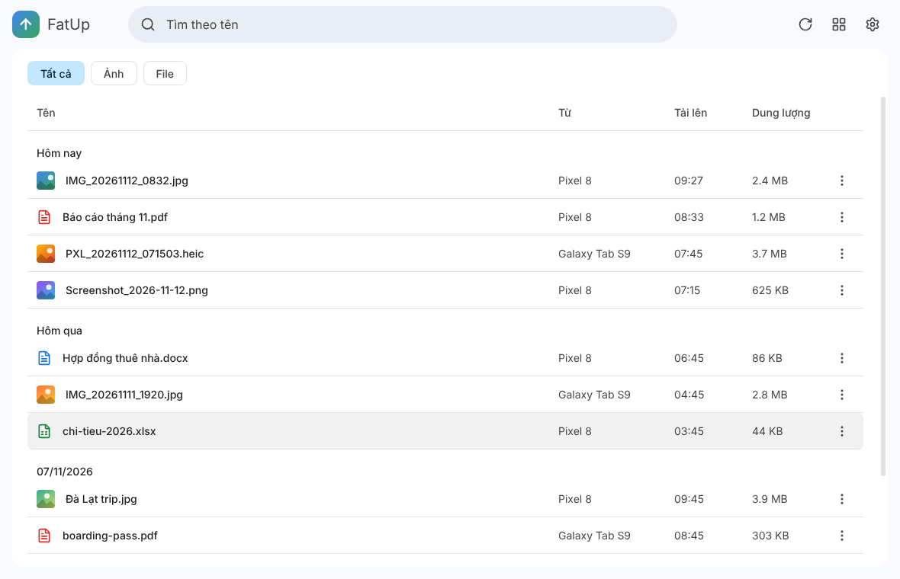
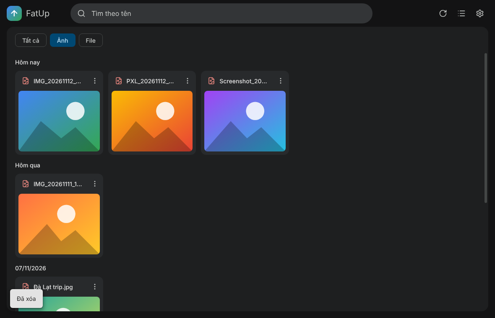

# FatUp

Ổ lưu trữ cá nhân **10 GB miễn phí** trên **Cloudflare R2**, chạy trong chính tài khoản Cloudflare của bạn. Dùng trên **web (PWA)**, **Android**, **macOS**, **Windows** và **Linux**.

| Danh sách (sáng) | Lưới ảnh (tối) |
|---|---|
|  |  |

## Tính năng chính

- **Ổ đĩa riêng 10 GB trên Cloudflare R2**, dùng trên web, Android, macOS, Windows, Linux
- **Gửi từ Android chỉ bằng Chia sẻ → FatUp**
- **Chia sẻ file bằng link công khai**
- **Két sắt cho file riêng tư**
- **Lưu liên kết, thùng rác, thẻ màu, giao diện sáng/tối**

Mô tả đầy đủ: [SPEC.md](SPEC.md). Thay đổi theo từng phiên bản: [CHANGELOG.md](CHANGELOG.md).

## Cài đặt

FatUp gồm một server (Cloudflare Worker) trong tài khoản của bạn, và bản web (PWA) do chính server đó phục vụ. Làm xong bước 1 và 2 là dùng được trên mọi trình duyệt; bước 3 là tùy chọn.

### Điều kiện tiên quyết

- **Tài khoản Cloudflare** (gói miễn phí là đủ: R2 10 GB, Workers 100 000 request/ngày, D1 5 GB).
- **R2 đã được bật**: Dashboard → **R2** → bật dịch vụ. Cloudflare có thể yêu cầu thêm phương thức thanh toán, nhưng dùng trong hạn mức miễn phí thì không mất phí.
- **Node.js 22** trở lên (kèm npm) và **git**.

### 1. Tạo server

```bash
git clone https://github.com/ThanhPhat1080/fatup && cd fatup
npm install
cd worker                                   # mọi lệnh tiếp theo chạy trong worker/
npx wrangler login                          # trình duyệt mở ra, bấm Allow
npx wrangler r2 bucket create fatup-files   # nơi chứa file
npx wrangler d1 create fatup                # nơi lưu thông tin file
```

Lệnh cuối in ra `database_id = "…"`. Chép giá trị đó vào dòng `database_id` trong `worker/wrangler.toml`, rồi tạo bảng:

```bash
npm run db:migrate:remote                   # gõ y khi được hỏi
```

Tạo **R2 API token**: Dashboard → **R2** → **Manage API tokens** → **Create API token**, quyền **Object Read & Write**, chỉ cho bucket `fatup-files`. Giữ lại *Access Key ID*, *Secret Access Key* (chỉ hiện một lần) và *Account ID*. Sau đó:

```bash
npx wrangler secret put R2_ACCESS_KEY_ID      # dán Access Key ID
npx wrangler secret put R2_SECRET_ACCESS_KEY  # dán Secret Access Key
npx wrangler secret put R2_ACCOUNT_ID         # dán Account ID
npm run token:new                             # in ra token đăng nhập của bạn: cất kỹ
npx wrangler secret put API_TOKEN             # dán token vừa tạo
npm run r2:cors                               # cho trình duyệt tải file thẳng lên R2
npm run deploy                                # build bản web và deploy Worker
```

Mỗi lệnh `secret put` hỏi `Enter a secret value:`: dán giá trị rồi Enter (màn hình không hiện ký tự). Nếu wrangler hỏi có tạo Worker mới không, chọn **Yes**.

`npm run deploy` in ra địa chỉ dạng `https://fatup.<tên-bạn>.workers.dev`. Kiểm tra: `curl https://fatup.<tên-bạn>.workers.dev/health` phải trả `{"ok":true}`.

### 2. Mở bản web và cài như app

1. Mở `https://fatup.<tên-bạn>.workers.dev` trên điện thoại hoặc máy tính.
2. Ô địa chỉ server đã điền sẵn. Dán token (từ `npm run token:new`) rồi đặt PIN 4 số.
3. Cài như app: Chrome/Edge chọn **Install app**; Safari trên iPhone chọn **Chia sẻ → Thêm vào MH chính**. Trên Android, bản web đã cài cũng hiện trong menu **Chia sẻ** để nhận link.

Bản web có gần đủ tính năng của app máy tính; chỉ thiếu mã QR để ghép app Android (dùng app máy tính cho việc này) và nút kiểm tra cập nhật (bản web tự cập nhật).

### 3. Cài app máy tính và Android (tùy chọn)

- [App máy tính](docs/install/desktop.md) cho **macOS**, **Windows**, **Linux**: thêm kiểm tra cập nhật và mã QR để ghép Android.
- [App Android](docs/install/android.md): gửi ảnh, file, link lên FatUp bằng **Chia sẻ → FatUp**.

### Nâng cấp server

Khi có bản mới, trong `worker/`, **luôn migrate trước rồi mới deploy**:

```bash
git pull && npm install
npm run db:migrate:remote
npm run deploy
```

Ghi chú riêng của từng bản nằm ở mục **Nâng cấp** trong [CHANGELOG.md](CHANGELOG.md).

## Bảo mật

- **Ai có token thì đọc và xóa được mọi file**, kể cả file trong két. Lộ token thì tạo token mới (`npm run token:new`, `npx wrangler secret put API_TOKEN`) rồi kết nối lại các thiết bị.
- PIN chỉ khóa giao diện và không bao giờ rời khỏi thiết bị. Sai 5 lần thì bị khóa 30 giây.
- **Két sắt không mã hóa nội dung file**: file vẫn nằm bình thường trên R2, chỉ bị che trong app.
- Trên bản web, token được mã hóa bằng PIN rồi lưu trong trình duyệt. Đừng dùng bản web trên máy dùng chung.
- Ai có link chia sẻ thì tải được file và chuyển tiếp được link; thu hồi bằng hạn hoặc **Dừng chia sẻ**.

Chi tiết: [docs/spec/security.md](docs/spec/security.md).

## Tài liệu khác

- [Phát triển và phát hành](docs/development.md): chạy local, test, build, tag release
- [SPEC.md](SPEC.md) (mô tả hệ thống) · [docs/decisions/](docs/decisions/README.md) (vì sao làm vậy) · [CLAUDE.md](CLAUDE.md) (hướng dẫn cho AI agent)
