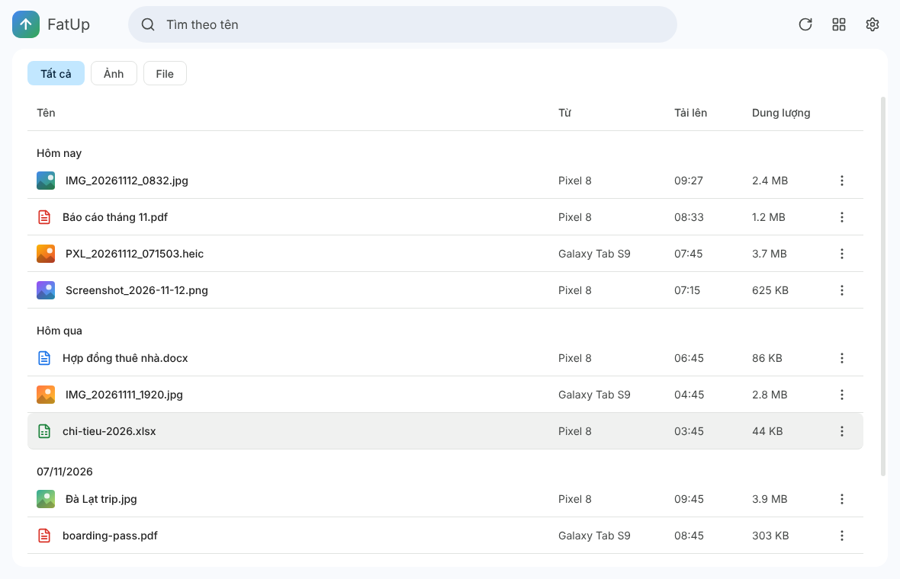
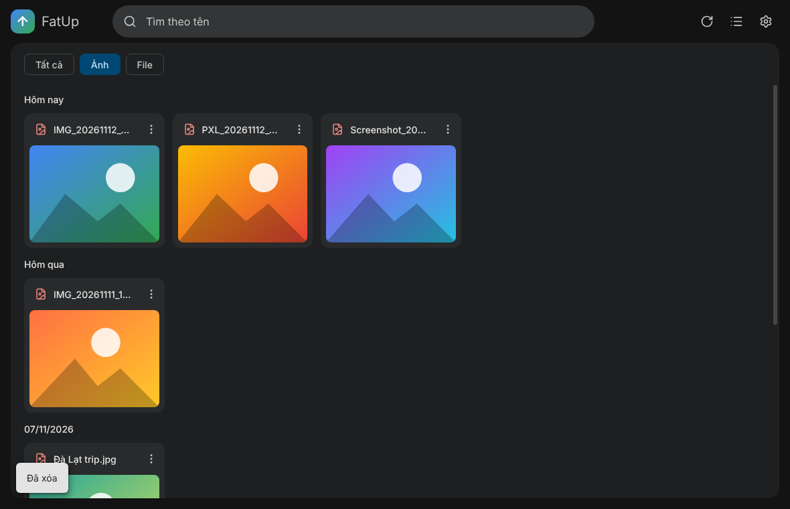
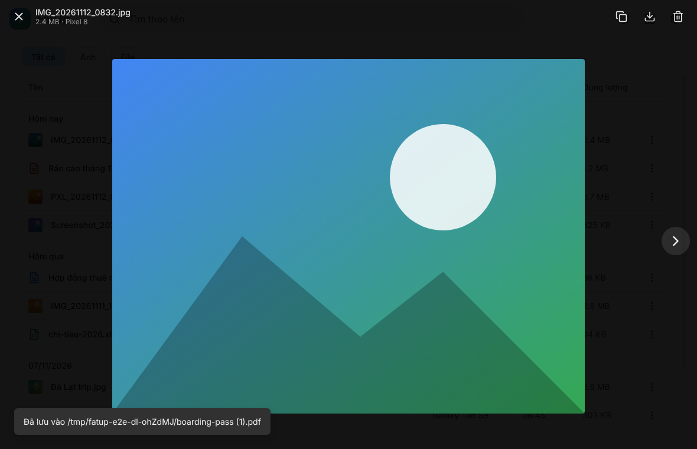
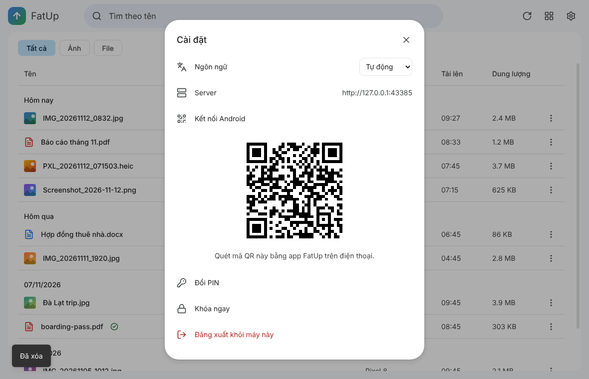

# FatUp

Gửi ảnh và file giữa **điện thoại Android** và **máy tính** (macOS, Ubuntu, Windows) qua một server cá nhân trên Cloudflare, miễn phí. Có thêm **bản web cài được như app (PWA)** (Phase 2).

| Danh sách (sáng) | Lưới ảnh (tối) |
|---|---|
|  |  |
| **Xem ảnh** | **Kết nối Android bằng QR** |
|  |  |

> Ảnh chụp ở trên là của bản đầu, giao diện hiện tại đã có thêm thùng rác, két sắt, thanh dung lượng, chọn nhiều file và chế độ tối chọn được.

## Tính năng

- **Android → máy tính:** chọn ảnh/file → **Chia sẻ → FatUp**. Mất mạng thì app xếp hàng rồi tự gửi lại.
- **Máy tính → cloud:** nút **Tải lên**, `Ctrl/⌘+U` hoặc kéo-thả file vào cửa sổ. Có bảng tiến trình kiểu Google Drive, hủy được từng file.
- **Danh sách:** mới nhất lên đầu, nhóm theo ngày, nút lọc **Ảnh / File / Liên kết** có số lượng ngay trên nút (bấm lại để bỏ lọc, không chọn gì là xem tất cả), tìm kiếm không phân biệt dấu, công tắc lưới / danh sách. Bấm tiêu đề cột để **sắp xếp** theo Tên / Tải lên / Dung lượng.
- **Quan trọng:** nhãn vàng (như Gmail) ngay sau checkbox của mọi file, ảnh, link; nút lọc nhanh có nhãn vàng đứng đầu thanh công cụ chỉ hiện mục quan trọng. Trong nhóm link, mục quan trọng lên đầu (tính lúc tải danh sách, nên đánh dấu xong item không nhảy chỗ).
- **Xem ngay trong app:** bấm link là mở khung xem trước thay vì tab mới: YouTube, TikTok, Instagram, Threads, X phát/hiện bằng trình nhúng chính thức; Facebook hiện thẻ tiêu đề + ảnh; trang web khác mở **nguyên trang** ngay trong app desktop (phiên riêng, không lưu đăng nhập), còn PWA hiện trang nếu trang cho nhúng, không thì hiện thẻ. Bấm **PDF** là xem bằng trình xem PDF của trình duyệt. `Ctrl/⌘` + bấm vẫn mở ngoài (link) hoặc tải về (PDF) như cũ.
- **Chọn nhiều file:** mỗi file có checkbox. `Shift`+bấm chọn một dãy, `Ctrl/⌘+A` chọn tất cả. Chuyển vào thùng rác hoặc két sắt hàng loạt, hoặc **Tải tất cả**.
- **Liên kết (bookmark):** chia sẻ một link từ Android (**Chia sẻ → FatUp**) hoặc từ bản web đã cài (PWA), hoặc bấm nút **Thêm liên kết** rồi dán URL. Link nằm ở tab **Liên kết**, tự phân loại theo nền tảng (**Facebook, YouTube, Instagram, Threads, X, TikTok, Internet**), sửa được tiêu đề và URL, gắn thẻ màu như file, **không bao giờ tự hết hạn**. Tiêu đề, ảnh xem trước và favicon của trang được tải khi bạn mở app (YouTube, TikTok luôn có; Instagram, Threads thường không cho đọc nên hiện con bò cowsay thay ảnh). Xem [bên dưới](#liên-kết-bookmark).
- **Đổi tên và thẻ màu:** bút chì cạnh mỗi file mở popover để đổi tên (giữ nguyên phần mở rộng) và gắn tối đa **3 chấm màu**. Nút hình hộp cạnh nút làm mới để **lọc theo màu**.
- **Xem ảnh:** vừa khung, zoom 10–800% (nút, lăn chuột, `+`/`-`, phím **↓ phóng to / ↑ thu nhỏ**), kéo để di chuyển, `←`/`→` chuyển ảnh, bảng **Chi tiết** (tên, loại, dung lượng, kích thước, thời gian, thiết bị).
- **Thùng rác:** xóa file là chuyển vào thùng rác, khôi phục được trong 30 ngày. Xem [bên dưới](#thùng-rác-trash).
- **Két sắt (Secret Vault):** cất file ra khỏi danh sách chính, mỗi lần mở phải nhập lại PIN. Xem [bên dưới](#két-sắt-secret-vault).
- **Thanh dung lượng (Store):** cạnh ô tìm kiếm, cho biết đã dùng bao nhiêu GB trên R2: xanh, **cam từ 70%**, **đỏ từ 90%**.
- **Giao diện:** En/Vi, **sáng/tối** (công tắc mặt trời/mặt trăng trong Cài đặt, mặc định theo hệ điều hành). Bấm logo FatUp để về trang chủ. Màn hình khóa là cảnh hoạt họa cổng Moria; cổng két sắt có ông phù thủy trên cầu đá.
- **Kiểm tra cập nhật** trong Cài đặt (app máy tính). File tự xóa sau **30 ngày** (link thì không), giới hạn **100 MB/file**.

### Liên kết (bookmark)

- **Ba đường vào:** (1) Android: trong trình duyệt hoặc app bất kỳ bấm **Chia sẻ → FatUp**; (2) PWA: sau khi cài, FatUp xuất hiện trong menu Chia sẻ của Android; link được giữ qua màn hình khóa PIN rồi lưu ngay khi bạn mở khóa; (3) nút **Thêm liên kết** (biểu tượng sợi xích cạnh Tải lên) trên desktop và web, tự điền link nếu clipboard đang có.
- **Lưu ngay, xem trước sau:** link được lưu tức thì với tiêu đề lấy từ nơi chia sẻ (hoặc tên miền). Khi bạn mở app, Worker đọc trang để lấy tiêu đề và địa chỉ ảnh xem trước (tối đa 20 link mỗi lần mở, mới nhất trước); **ảnh do chính app tải và giữ trên máy bạn** (thư mục dữ liệu của app, hoặc bộ nhớ của trình duyệt với PWA), Worker không lưu ảnh. Ảnh của link trong Két sắt không được lưu lại. **Tải lại xem trước** nằm trong menu `⋮`.
- **Phân loại theo nền tảng** (hàng nút tròn trong tab Liên kết: Tất cả, Internet, YouTube, một đường kẻ, rồi hộp **Mạng xã hội** bấm vào để Facebook, Instagram, Threads, X, TikTok nhảy ra; logo thật của từng nền tảng, trang web khác hiện favicon của chính nó; danh sách có cột Nguồn để sắp xếp theo nền tảng). Kết hợp được với lọc theo màu, lọc quan trọng và tìm kiếm (theo tiêu đề và URL).
- **Nhóm theo nền tảng / tên miền:** khi đang xem Tất cả, link được gom thành nhóm (mỗi nền tảng một nhóm, `youtu.be` và `youtube.com` chung nhóm YouTube; trang web khác nhóm theo tên miền), tiêu đề nhóm có icon và số lượng, bấm để gập/mở; công tắc trên thanh công cụ gập/mở tất cả.
- **Danh sách link:** cột nút sửa / sao chép canh thẳng hàng bên phải, rê chuột hoặc focus hiện thêm nút **mở trong trình duyệt**.
- **Sửa liên kết:** bút chì → popover có ô Tiêu đề, ô URL và chấm màu. Đổi URL thì xem trước được tải lại. URL đã lưu rồi thì báo "Liên kết này đã có".
- Link có thể vào két sắt hoặc thùng rác như file; **không tự xóa sau 30 ngày**. Bản app cũ không thấy link (server không trả link cho danh sách file thường).
- **PWA đã cài trước đây:** Android cập nhật mục "Chia sẻ" của PWA chậm (tới khoảng một ngày sau khi bản web mới được deploy), có thể phải gỡ rồi cài lại PWA.
- Nâng cấp server: `npm run db:migrate:remote` (migration `0005` **dựng lại bảng `files`**, nên sao lưu D1 trước) rồi `npm run deploy`.

### Thùng rác (Trash)

- **Xóa = chuyển vào thùng rác**, không xóa thật và không hỏi xác nhận. Thông báo hiện nút **Hoàn tác** trong vài giây.
- Mở thùng rác bằng biểu tượng thùng rác ở thanh trên cùng (nút ← để quay lại). Ở đó bạn **Khôi phục** file về danh sách chính, **Xóa vĩnh viễn** từng file hoặc nhiều file, hay **Dọn sạch thùng rác**. Xóa vĩnh viễn và dọn sạch đều có hộp xác nhận vì không hoàn tác được.
- File trong thùng rác chưa mở/tải được, phải khôi phục trước.
- File nằm trong thùng rác **30 ngày thì bị xóa vĩnh viễn** (cron chạy 03:00 UTC mỗi ngày). File được khôi phục thì được tính lại 30 ngày kể từ lúc khôi phục, nên file cũ khôi phục xong sẽ không bị xóa ngay đêm đó.
- File trong thùng rác vẫn chiếm dung lượng R2 cho đến khi bị xóa vĩnh viễn.

### Két sắt (Secret Vault)

Một khu vực để **cất file ra khỏi danh sách chính**. Chỉ xem được sau khi nhập lại mã PIN.

- **Cất vào:** menu `⋮`/chuột phải, hoặc thanh chọn nhiều file → **Chuyển vào Két sắt**. File biến mất khỏi danh sách chính.
- **Mở két:** bấm biểu tượng két sắt cạnh thùng rác, app luôn bắt nhập lại PIN (kể cả khi app đang mở khóa). Thoát ra (nút ←, bấm logo, vào thùng rác, khóa app) là két đóng lại, lần sau phải nhập PIN lại. Sai PIN dùng chung giới hạn 5 lần / khóa 30 giây với màn hình khóa.
- **Trong két:** xem, tải, copy ảnh, tìm kiếm, chọn nhiều file như bình thường. Có **Đưa ra khỏi Két sắt** để trả file về danh sách chính. Tải file lên khi đang mở két thì file vào thẳng két.
- **Xóa file trong két:** file ra khỏi két và vào thùng rác thường. Bấm **Hoàn tác** sẽ đưa nó về két.
- **Lưu ý quan trọng:** két sắt là lớp che ở giao diện app, **không phải mã hóa**. File vẫn nằm bình thường trên R2, và ai có API token (ví dụ app Android hay client khác) vẫn có thể thấy chúng qua API. File trong két vẫn tính vào dung lượng và vẫn tự xóa sau 30 ngày như mọi file.

Thiết kế chi tiết nằm ở [SPEC.md](SPEC.md). Lịch sử thay đổi theo từng phiên bản nằm ở [CHANGELOG.md](CHANGELOG.md).

## Cấu trúc

```
worker/    Cloudflare Worker (Hono) + D1 (metadata) + R2 (file); phục vụ luôn bản web
desktop/   App Electron (electron-vite + React + TS)
web/       Bản web PWA, dùng chung giao diện với desktop
android/   App Android (Kotlin, chỉ có share target + màn hình kết nối)
shared/    Kiểu dữ liệu API dùng chung
```

File đi thẳng giữa thiết bị và R2 qua presigned URL. Worker chỉ cấp URL và lưu metadata.

---

## 1. Deploy server (Cloudflare, miễn phí)

Cần tài khoản Cloudflare và Node 22.

> **Lưu ý:** từ bước 2 trở đi, mọi lệnh đều chạy **trong thư mục `worker/`** (trừ khi có ghi khác). Chạy ở thư mục gốc sẽ báo lỗi `Missing script`.

### Bước 1. Tải code và cài thư viện

```bash
git clone https://github.com/ThanhPhat1080/fatup && cd fatup
```

```bash
npm install
```

### Bước 2. Đăng nhập Cloudflare

```bash
cd worker
```

```bash
npx wrangler login
```

Trình duyệt sẽ mở ra, bạn bấm **Allow**.

### Bước 3. Tạo bucket R2 (nơi chứa file)

```bash
npx wrangler r2 bucket create fatup-files
```

### Bước 4. Tạo database D1 (nơi lưu metadata)

```bash
npx wrangler d1 create fatup
```

Lệnh in ra một đoạn có dòng `database_id = "xxxxxxxx-xxxx-…"`. Copy chuỗi UUID đó, mở file `worker/wrangler.toml` và thay vào dòng `database_id` (đang là chuỗi mẫu `00000000-…`):

```toml
[[d1_databases]]
binding = "DB"
database_name = "fatup"
database_id = "dán-id-của-bạn-vào-đây"
```

Sau đó tạo các bảng trong database:

```bash
npm run db:migrate:remote
```

Khi wrangler hỏi xác nhận, gõ `y`.

### Bước 5. Tạo R2 API token

Token này để Worker ký presigned URL.

1. Vào Dashboard → **R2** → **Manage API tokens** → **Create API token**.
2. Chọn quyền **Object Read & Write**, giới hạn vào bucket `fatup-files`.
3. Sau khi tạo, giữ lại 3 giá trị: *Access Key ID*, *Secret Access Key* và *Account ID* (Account ID nằm trong URL dashboard hoặc trang R2). Secret Access Key chỉ hiện một lần.

### Bước 6. Lưu 3 giá trị trên thành secret

Mỗi lệnh dưới đây có phần tên secret cố định (`R2_ACCESS_KEY_ID`…), bạn gõ nguyên như vậy. Sau khi bấm Enter, wrangler hỏi `Enter a secret value:`, lúc đó bạn dán **giá trị** tương ứng rồi Enter. Khi dán, màn hình không hiện ký tự nào, đó là bình thường.

```bash
npx wrangler secret put R2_ACCESS_KEY_ID
```
→ dán *Access Key ID*

```bash
npx wrangler secret put R2_SECRET_ACCESS_KEY
```
→ dán *Secret Access Key*

```bash
npx wrangler secret put R2_ACCOUNT_ID
```
→ dán *Account ID*

Nếu wrangler hỏi có muốn tạo Worker mới không, chọn **Yes**.

### Bước 7. Tạo token đăng nhập của riêng bạn

Đây là "mật khẩu" để app máy tính và app Android nói chuyện với server. Lệnh dưới in ra một chuỗi ngẫu nhiên, hãy cất kỹ chuỗi này:

```bash
npm run token:new
```

Rồi lưu nó thành secret `API_TOKEN` (dán chuỗi vừa tạo khi được hỏi giá trị):

```bash
npx wrangler secret put API_TOKEN
```

### Bước 8. Deploy

```bash
npm run deploy
```

Lệnh in ra URL kiểu `https://fatup.<tên-bạn>.workers.dev`. Kiểm tra nhanh:

```bash
curl https://fatup.<tên-bạn>.workers.dev/health
```

Kết quả đúng là `{"ok":true}`. Cron dọn dẹp chạy lúc 03:00 UTC mỗi ngày: xóa file quá 30 ngày kể từ lúc tải lên, file đã nằm trong thùng rác quá 30 ngày, và các lượt tải lên dở dang quá 24 giờ.

### Bước 9. Dùng bản web (PWA)

`npm run deploy` build luôn bản web và đẩy lên cùng Worker, nên không cần deploy thêm gì. Mở `https://fatup.<tên-bạn>.workers.dev` trên trình duyệt (điện thoại hay máy tính đều được):

1. Ô URL đã điền sẵn, bạn chỉ cần dán token (chuỗi tạo ở bước 7) rồi đặt PIN 4 số.
2. Cài như một app: Chrome/Edge chọn **Install app**, Safari (iPhone) chọn **Share → Add to Home Screen**.

Bản web có giao diện và tính năng giống app máy tính: xem, **tải file lên** (nút Tải lên, kéo-thả, hoặc chụp/chọn ảnh từ điện thoại), tải về, đổi tên, thẻ màu, thùng rác, két sắt, chọn nhiều file, sắp xếp. Chỉ thiếu **kiểm tra cập nhật** (web tự cập nhật) và **ghép QR cho Android**.

Trên điện thoại, giao diện tự gọn lại cho màn hình nhỏ: **giữ lâu** một file để chọn nhiều file, trong trình xem ảnh thì **chụm hai ngón** để zoom, **vuốt ngang** đổi ảnh, **vuốt xuống** để đóng.

**Lưu ý bảo mật:** token được mã hóa bằng PIN rồi lưu trong trình duyệt. PIN 4 số chỉ là khóa che màn hình, không chống được người có quyền truy cập vào dữ liệu trình duyệt của bạn. Đừng dùng bản web trên máy dùng chung.

**Cấu hình CORS cho bucket R2 (làm một lần, cần để tải file lên từ web):** trình duyệt gửi file thẳng lên R2 bằng presigned URL nên bucket phải cho phép. Trong `worker/`:

```bash
npm run r2:cors
```

Lệnh này áp dụng `worker/r2-cors.json` (cho phép `GET`, `HEAD`, `PUT` từ mọi origin; request vẫn phải có chữ ký presigned nên không ai khác ghi được vào bucket). Muốn chặt hơn, đổi `"*"` thành địa chỉ Worker của bạn. Chưa cấu hình thì tải lên từ web báo lỗi mạng. Nút **Copy ảnh** cũng dùng CORS này; không có thì nó copy ảnh xem trước thay cho ảnh gốc.

### Nâng cấp server từ bản cũ

Mỗi lần có bản mới, chạy lại hai lệnh này trong `worker/`, **theo đúng thứ tự: migration trước, deploy sau**. Các bản mới thêm cột vào database (thùng rác: migration `0002`, két sắt: migration `0003`), nên deploy mà chưa migrate thì server sẽ lỗi:

```bash
npm run db:migrate:remote
```

```bash
npm run deploy
```

Ghi chú:

- App máy tính bản cũ (trước khi có thùng rác) nối vào server mới vẫn xóa được file, nhưng file đi vào thùng rác chứ không bị xóa hẳn, và app cũ không có giao diện thùng rác. Hãy cập nhật app trên mọi máy.
- **Thanh dung lượng** dùng đường `/usage` của server. Nếu server chưa deploy bản mới, app tự cộng dung lượng các file nó thấy. Giới hạn hiển thị mặc định là 10 GB (gói miễn phí của R2); muốn đổi thì thêm `R2_QUOTA_GB = "50"` vào mục `[vars]` của `worker/wrangler.toml`.
- Số dung lượng lấy từ database nên không tính ảnh xem trước và có thể lệch nhẹ so với dashboard Cloudflare.

## 2. Cài app máy tính

Tải bản cài trong mục [Releases](https://github.com/ThanhPhat1080/fatup/releases), hoặc tự build (xem phần 5).

- **macOS** (`.dmg`): app không được ký, nên lần đầu phải chuột phải → **Open**. Nếu báo "app bị hỏng", chạy:

  ```bash
  xattr -cr /Applications/FatUp.app
  ```

- **Windows** (`.exe`): SmartScreen sẽ cảnh báo, chọn **More info → Run anyway**.
- **Ubuntu**: dùng file `AppImage` (`chmod +x` rồi chạy).

**Cập nhật:** vào **⚙ Cài đặt → Kiểm tra cập nhật**. Windows và Linux AppImage tự tải và cài, macOS thì mở trang tải về. Chỉ thấy bản mới sau khi bản release được **Publish** (không phải draft).

Lần đầu mở app: dán **URL Worker** và **API token** → **Tiếp** → đặt **PIN 4 số**. Mỗi máy có PIN riêng. Quên PIN thì bấm "Quên PIN? Đặt lại" rồi nhập lại token.

## 3. Cài app Android

Tải file `FatUp-*-android.apk` trong Releases và cài (Android 9 trở lên; cần cho phép "cài từ nguồn không xác định").

Kết nối: trên máy tính vào **⚙ Cài đặt → Kết nối Android**, nhập PIN để hiện mã QR. Trên điện thoại mở FatUp → **Quét mã QR**. Cách khác là quét QR bằng camera của máy, link `fatup://` sẽ tự mở app.

Gửi file: ở bất kỳ app nào, chọn ảnh/file → **Chia sẻ → FatUp**.

## 4. Phát triển local

```bash
npm install
```

Worker (D1/R2 giả lập bằng Miniflare). Trước khi chạy dev, chép `worker/.dev.vars.example` thành `worker/.dev.vars`:

```bash
npm run -w @fatup/worker db:migrate:local
```

```bash
npm run -w @fatup/worker dev
```

Desktop (dùng chung cấu hình với app FatUp đã cài, nên nối thẳng vào server thật; `dev:desktop:fresh` dùng một hồ sơ riêng trong `.dev-userdata/`, thêm `FATUP_SERVER=https://…` để điền sẵn địa chỉ server):

```bash
npm run dev:desktop
```

Web (PWA, dùng chung giao diện với desktop, chạy ở http://localhost:5173). Muốn dùng database và file thật trên server: chép `web/.env.example` thành `web/.env.local` và điền `FATUP_SERVER=https://fatup.<tên-bạn>.workers.dev`; Vite sẽ chuyển các lệnh gọi API sang Worker đó (Worker không bật CORS nên phải qua proxy). Ở màn hình thiết lập giữ nguyên địa chỉ `localhost:5173` đã điền sẵn và nhập token thật:

```bash
npm run dev:web
```

Server: `npm run release:worker` = migrate D1 trên server rồi deploy Worker (kèm PWA); hoặc từng bước `npm run db:migrate`, `npm run deploy:worker`.

Test:

```bash
npm test
```

```bash
npm run -w @fatup/desktop e2e
```

Chỉ muốn kiểm tra màn hình khóa trên điện thoại (cửa Moria, lắc PIN, nháy đèn, mở cửa) thì chạy `npm run -w @fatup/desktop e2e:lock`, nhanh hơn nhiều.

Lệnh `e2e` build app rồi điều khiển nó bằng Playwright, dùng một API giả. Trên Linux không có màn hình thì chạy qua `xvfb-run -a`. Đặt biến `SCREENSHOT_DIR=…` để lưu ảnh chụp từng màn hình.

Android (cần JDK 21 và Android SDK có `platforms;android-37.0`):

```bash
cd android && ./gradlew testDebugUnitTest assembleDebug
```

## 5. Phát hành

Push một tag, GitHub Actions sẽ build `.dmg` (Apple Silicon), `.exe`, `AppImage` và APK, rồi tạo **draft release**:

```bash
git tag v0.1.0 && git push origin v0.1.0
```

**Nên tạo keystore Android cố định.** Nếu không, mỗi lần CI build APK sẽ được ký bằng một key ngẫu nhiên khác nhau, và bản mới sẽ không cài đè được lên bản cũ. Tạo keystore một lần:

```bash
keytool -genkeypair -v -keystore fatup.jks -alias fatup -keyalg RSA -keysize 2048 -validity 10000
```

Sau đó thêm 4 secret vào repo (Settings → Secrets and variables → Actions): `ANDROID_KEYSTORE_BASE64` (giá trị của `base64 -w0 fatup.jks`), `ANDROID_KEYSTORE_PASSWORD`, `ANDROID_KEY_ALIAS` (`fatup`) và `ANDROID_KEY_PASSWORD`. Đừng commit file `.jks`.

## Bảo mật (tóm tắt)

- Mọi request API đều cần token dài 32 byte. **Ai có token thì đọc và xóa được mọi file**, kể cả file trong Két sắt.
- PIN 4 số chỉ khóa giao diện, không bao giờ rời khỏi thiết bị. Sai 5 lần thì khóa 30 giây. Két sắt dùng chính PIN này nhưng bắt nhập lại mỗi lần mở.
- Token trên máy tính được mã hóa bằng keychain của hệ điều hành (Electron `safeStorage`). Trên Linux không có keyring thì app lưu dạng base64.
- Token trên Android nằm trong storage riêng của app và bị loại khỏi backup.
- Token trên bản web được mã hóa bằng PIN (AES-GCM, PBKDF2) rồi lưu trong trình duyệt. PIN 4 số chỉ có 10.000 tổ hợp nên chỉ che màn hình, không chống được người đọc được dữ liệu trình duyệt của bạn. Đừng dùng bản web trên máy dùng chung.
- **Két sắt không mã hóa nội dung file** (xem phần Két sắt ở trên).
- Lộ token thì tạo token mới bằng `npm run token:new` và `wrangler secret put API_TOKEN`, rồi kết nối lại các thiết bị.
